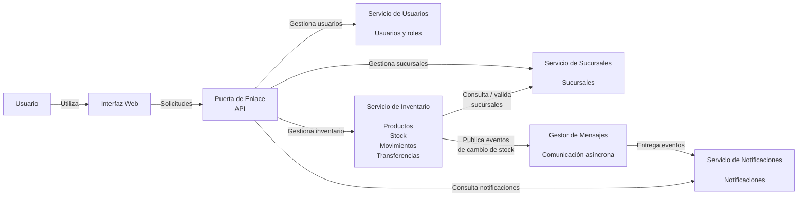

# Diagrama de Contenedores

El siguiente diagrama muestra los principales componentes que forman parte de Stock Volcamelli y las relaciones entre ellos.

## Componentes

### Interfaz Web

Proporciona la interfaz mediante la cual los usuarios interactúan con Stock Volcamelli.

### Puerta de Enlace API

Es el punto de entrada para las solicitudes provenientes de la interfaz web.

Se encarga de dirigir cada solicitud hacia el servicio correspondiente.

### Servicio de Usuarios

Responsable de la gestión de:

- Usuarios.
- Roles.

Los roles definidos son:

- `ADMIN`
- `OPERATOR`

### Servicio de Sucursales

Responsable de la gestión de las sucursales de la empresa.

### Servicio de Inventario

Es el servicio principal del dominio de inventario.

Responsabilidades:

- Gestionar productos.
- Gestionar stock por sucursal.
- Registrar movimientos de inventario.
- Realizar transferencias entre sucursales.
- Validar disponibilidad de stock.
- Mantener las reglas de consistencia del inventario.
- Generar eventos relacionados con cambios relevantes del stock.

El Servicio de Inventario constituye la capacidad publicada por el grupo para la integración con otro grupo.

### Servicio de Notificaciones

Responsable de gestionar las notificaciones generadas a partir de eventos relevantes del sistema.

Tipos principales:

- `LOW_STOCK`
- `OUT_OF_STOCK`

### Gestor de Mensajes

Permite realizar la comunicación asíncrona entre el Servicio de Inventario y el Servicio de Notificaciones.

El Servicio de Inventario publica eventos de cambio de stock y el Servicio de Notificaciones los consume.

## Comunicación

El sistema contempla dos tipos principales de comunicación:

- **Comunicación síncrona:** el Servicio de Inventario puede comunicarse con el Servicio de Sucursales para validar información de las sucursales.
- **Comunicación asíncrona:** el Servicio de Inventario publica eventos mediante el Gestor de Mensajes, que posteriormente son consumidos por el Servicio de Notificaciones.