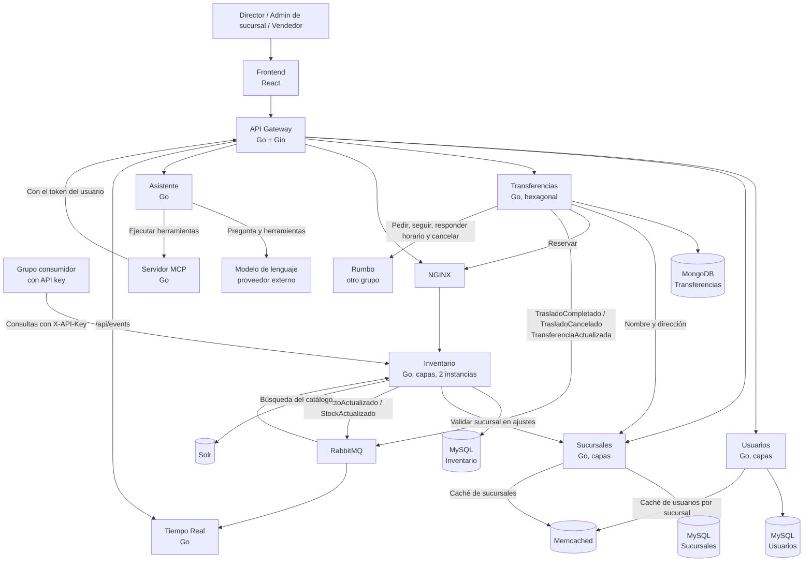

# Diagrama de contenedores

Muestra las piezas del sistema y cómo se comunican.

## Qué es cada cosa

| Contenedor | Qué hace |
|---|---|
| Frontend | La aplicación web que usan el director, los admins de sucursal y los vendedores, con el chat del asistente |
| API Gateway | La única entrada. Valida el token, controla permisos y manda cada pedido a su servicio |
| Usuarios | Usuarios con su rol y su sucursal, y login |
| Sucursales | Sucursales con su dirección |
| Inventario | Catálogo, stock, reservas y movimientos. Corre en dos instancias |
| NGINX | Reparte los pedidos entre las dos instancias de Inventario |
| Transferencias | Transferencias y comunicación con Rumbo |
| Asistente | Recibe los mensajes del chat y coordina el modelo de lenguaje con las herramientas |
| Servidor MCP | Expone las operaciones del sistema como herramientas para el modelo. Cada una es una llamada al gateway |
| Tiempo Real | Le manda al frontend los cambios de stock y de transferencias apenas pasan |
| RabbitMQ | Lleva los eventos entre servicios |
| Solr | Índice para buscar en el catálogo |
| Memcached | Caché de los datos de cada sucursal y de sus usuarios |

Cada servicio usa solo su propia base. Solr y Memcached no son fuente de verdad: si se pierden, Solr se reconstruye desde el MySQL de Inventario y Memcached se vuelve a llenar desde los MySQL de Usuarios y Sucursales.

Los pedidos a Inventario pasan siempre por NGINX, vengan del gateway o de Transferencias. Las demás llamadas entre servicios van directo, sin pasar por el gateway, salvo las del servidor MCP: pasan por el gateway a propósito, para que el asistente tenga los mismos permisos que el usuario. A Rumbo solo le habla Transferencias.

Las piezas de observabilidad (el MySQL de logs, Prometheus y Grafana) no están en el diagrama para no cargarlo: leen los logs, las métricas y las trazas de todos los servicios ([ADR-011](../adr/ADR-011-observabilidad.md)).
