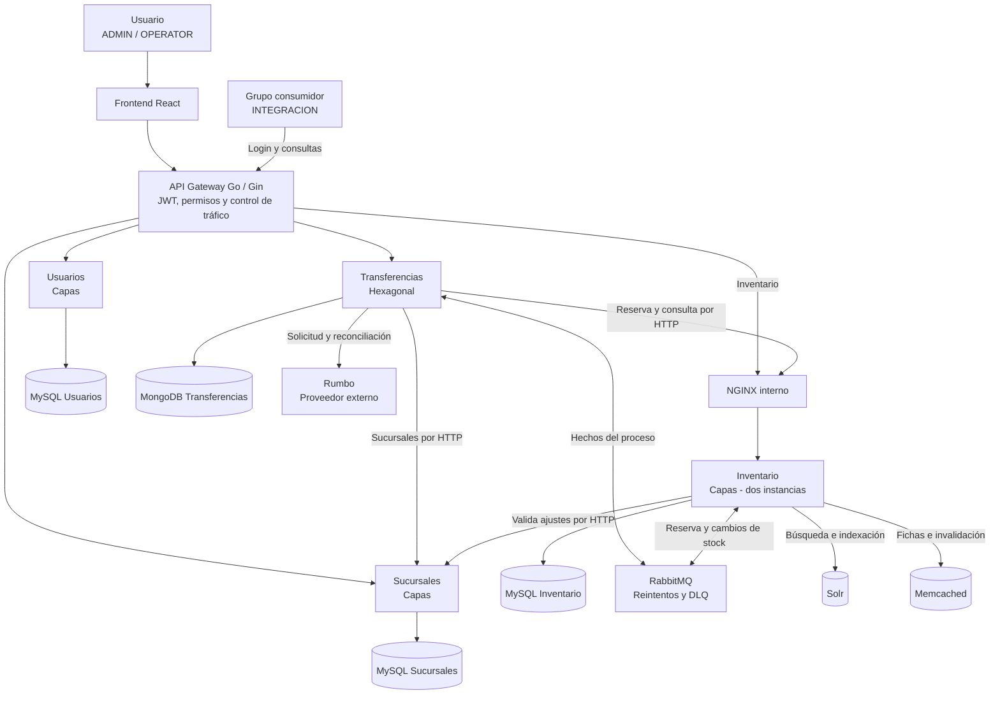
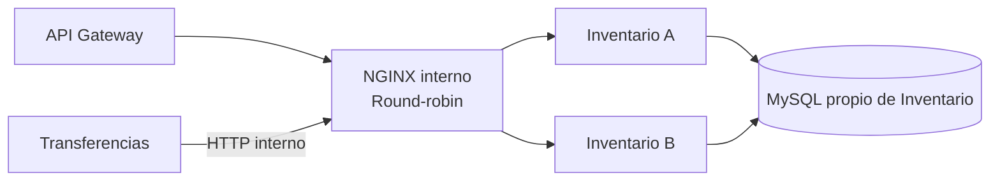

# Diagrama de Contenedores

Diseño planificado. La vista general agrupa las dos instancias de Inventario; la segunda vista muestra su distribución detrás de NGINX. Ambas instancias y sus trabajadores pertenecen al mismo servicio.

## Dos instancias de Inventario

Las llamadas de Transferencias llegan al balanceador interno sin volver al gateway. NGINX detecta fallas a partir del tráfico y excluye temporalmente la instancia; los healthchecks de Docker no la retiran automáticamente. Las dos instancias usan también el mismo Solr y Memcached del servicio, y compiten dentro de las colas que les corresponden.

## Propiedad y acceso

| Servicio | Datos propios |
|---|---|
| Usuarios | Usuarios, credenciales y roles |
| Sucursales | Sucursales y direcciones |
| Inventario | Productos, existencias totales/reservadas, reservas, movimientos, idempotencia y outbox |
| Transferencias | Proceso, estados, historial, decisión, id de Rumbo y outbox |

Cada servicio accede solo a su base. Inventario es el único que modifica cantidades. Transferencias no copia el stock; los registros idempotentes de Inventario no duplican el proceso de Transferencias. Solr y Memcached son copias reconstruibles.

El indexador y el trabajador de invalidación son parte de Inventario, no otro microservicio de negocio. Consumen sus eventos desde RabbitMQ, leen solo su MySQL, actualizan Solr y borran las fichas afectadas de Memcached.

## Caminos de comunicación

- Frontend y consumidor → gateway. Roles vigentes: `ADMIN`, `OPERATOR`, `INTEGRACION`; este último solo lee el contrato.
- Gateway → NGINX → Inventario A/B. Las restantes rutas van al servicio responsable.
- Transferencias → Sucursales/Rumbo y Transferencias → NGINX → Inventario. Las llamadas internas y externas salen del servicio responsable.
- Transferencias → RabbitMQ → Inventario: `TrasladoAceptado`, `TrasladoRechazado` o `SolicitudVencida` para confirmar/liberar.
- Inventario → RabbitMQ → Transferencias: `ReservaConfirmada` o `ReservaLiberada` para completar el estado.
- Inventario → RabbitMQ → sus trabajadores: cambios de producto/disponible para Solr e invalidación de fichas.

Las flechas dobles con RabbitMQ representan publicación y consumo mediante colas separadas. Los nombres de eventos son nuestros: el contrato de Rumbo lo entrega el otro grupo y sigue pendiente.

La [arquitectura](../ARCHITECTURE.md) precisa tiempos, reintentos, frescura, evidencia y limitaciones.
