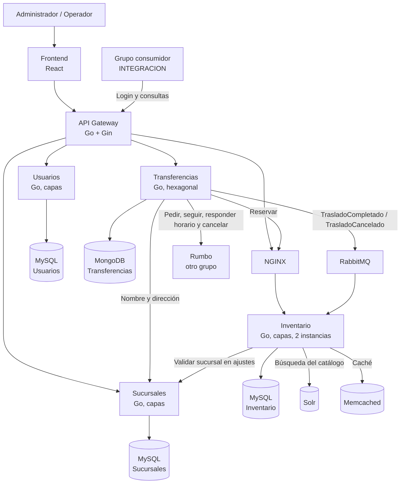

# Diagrama de contenedores

Muestra las piezas del sistema y cómo se comunican.

## Qué es cada cosa

| Contenedor | Qué hace |
|---|---|
| Frontend | La aplicación web que usan el administrador y el operador |
| API Gateway | La única entrada. Valida el token, controla permisos, limita pedidos y manda cada pedido a su servicio |
| Usuarios | Usuarios, login y roles |
| Sucursales | Sucursales con su dirección |
| Inventario | Catálogo, stock, reservas y movimientos. Corre en dos instancias |
| NGINX | Reparte los pedidos entre las dos instancias de Inventario |
| Transferencias | Transferencias y comunicación con Rumbo |
| RabbitMQ | Lleva los eventos de Transferencias a Inventario |
| Solr | Índice para buscar en el catálogo |
| Memcached | Caché de las consultas del catálogo |

Cada servicio usa solo su propia base. Solr y Memcached no son fuente de verdad: si se pierden, se reconstruyen desde el MySQL de Inventario.

Los pedidos a Inventario pasan siempre por NGINX, vengan del gateway o de Transferencias. Las demás llamadas entre servicios van directo, sin pasar por el gateway. A Rumbo solo le habla Transferencias.
