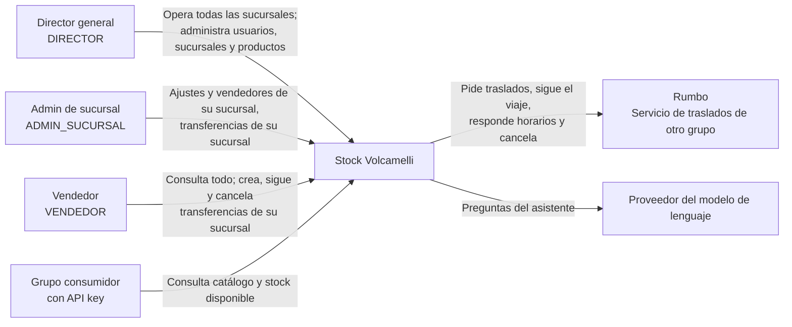

# Diagrama de contexto

Muestra quién usa Stock Volcamelli y con qué sistemas externos se comunica.

- **Director general, admin de sucursal y vendedor** usan el sistema desde el frontend. El admin de sucursal y el vendedor trabajan en una sola sucursal; el director, en todas.
- **El grupo consumidor** es otro sistema que consulta nuestro catálogo y stock con una API key, directo a Inventario publicado. Solo puede leer.
- **Rumbo** es el servicio de transporte de otro grupo. Le pedimos cada traslado y lo seguimos hasta que termina. Si llega, el stock pasa al destino. Si se rechaza, se cancela o no se realiza, vuelve a estar disponible en el origen.
- **El proveedor del modelo de lenguaje** es el servicio externo que usa el asistente del frontend para entender las preguntas y elegir qué herramientas usar. En desarrollo es un modelo local.

El detalle por dentro está en el [diagrama de contenedores](contenedores.md).
