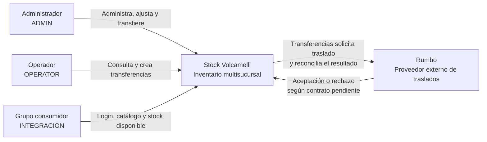

# Diagrama de Contexto

Diseño planificado para Stock Volcamelli. El grupo consumidor usa nuestro catálogo y stock; Rumbo es el proveedor de traslados. Su contrato lo entrega el otro grupo.

`ADMIN` administra usuarios, sucursales, productos y ajustes, además de operar. `OPERATOR` consulta inventario y crea transferencias. `INTEGRACION` solo lee las consultas del contrato.

El disponible es total menos reservado. La aceptación de Rumbo habilita la confirmación contable por Inventario; no seguimos el viaje físico. Las llamadas al proveedor salen de Transferencias. La interfaz y el consumidor entran por el API Gateway; los detalles internos están en el [diagrama de contenedores](contenedores.md).
