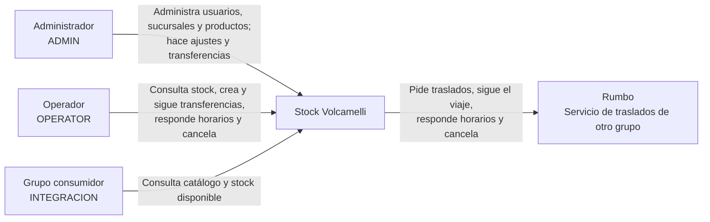

# Diagrama de contexto

Muestra quién usa Stock Volcamelli y con qué sistemas externos se comunica.

- **Administrador y operador** usan el sistema desde el frontend.
- **El grupo consumidor** es otro sistema que consulta nuestro catálogo y stock con la cuenta `INTEGRACION`. Solo puede leer.
- **Rumbo** es el servicio de transporte de otro grupo. Le pedimos cada traslado y lo seguimos hasta que termina. Si llega, el stock pasa al destino. Si se rechaza, se cancela o no se realiza, vuelve a estar disponible en el origen.

El detalle por dentro está en el [diagrama de contenedores](contenedores.md).
