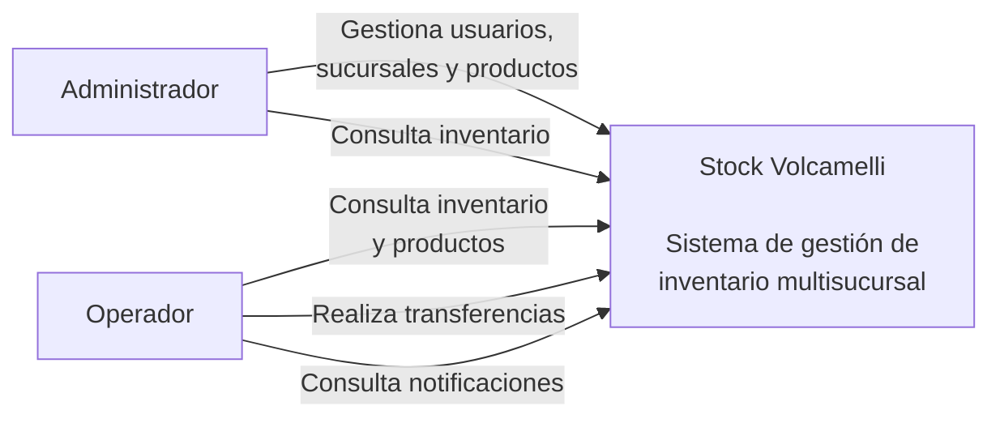

# Diagrama de Contexto

El siguiente diagrama representa el sistema Stock Volcamelli y los actores que interactúan con él.

## Actores

### Administrador

El administrador puede:

- Gestionar usuarios.
- Gestionar sucursales.
- Gestionar productos.
- Consultar el inventario.

### Operador

El operador puede:

- Consultar productos.
- Consultar el inventario.
- Realizar transferencias de productos entre sucursales.
- Consultar notificaciones.

## Sistema

**Stock Volcamelli** es un sistema distribuido orientado a la gestión de inventario de empresas con múltiples sucursales.

El sistema permite administrar productos, consultar stock por sucursal, realizar transferencias entre establecimientos y gestionar notificaciones relacionadas con los niveles de stock.
